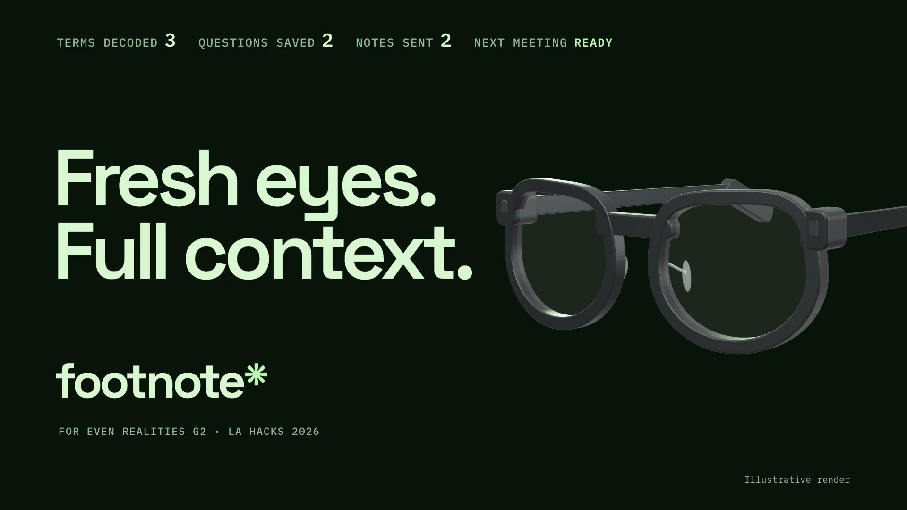
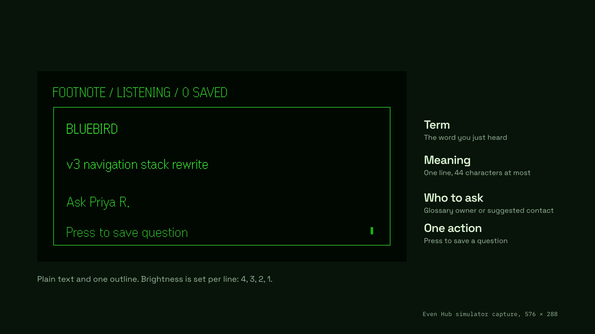

# Footnote



A little context for your first week. Footnote listens during a meeting,
shows unfamiliar company terms and their owners on Even G2 glasses, and
lets you queue questions to send after the meeting.

## Live demo

| Try it | Link |
| --- | --- |
| Meeting digest dashboard | [Open dashboard](https://web-production-d828b.up.railway.app) |
| Footnote Jargon Decoder in ASI:One | [Chat with the agent](https://asi1.ai/ai/agent1qtm5jg9yr7e35ysxxahsvwc84g2yx95dkljesugg9xvdwmy8lp655tm2u2r) |
| Public draft review and approval demo | [View shared chat](https://asi1.ai/shared-chat/3e91ca9e-4730-4f89-bf64-0c24467f87e1) |
| Agentverse profile | [View registered agent](https://agentverse.ai/agents/details/agent1qtm5jg9yr7e35ysxxahsvwc84g2yx95dkljesugg9xvdwmy8lp655tm2u2r/profile) |
| Production backend | [API origin](https://backend-production-17d9.up.railway.app) · [Health check](https://backend-production-17d9.up.railway.app/health) |

The phone controls run inside the **Footnote** Even Hub Beta; the dashboard shows
the post-meeting digest. For the physical glasses experience, follow [Run on G2](#run-on-g2).
The hosted demo uses a synthetic Halcyon company glossary. Approved emails go to
the configured demo inbox, with coworkers used as display recipients.

## Project layout

- `glasses/`: TypeScript + Vite + Even SDK. Three text containers, gestures,
  16 kHz PCM upload, meeting controls, queued questions, and draft approval.
  The phone interface is in `glasses/src/main.ts`, without a UI framework.
- `web/`: React + Vite meeting digest: learned terms, people, sent messages.
- `backend/`: FastAPI + SQLite, ElevenLabs transcription, StepFun inference and
  Resend delivery. See [backend setup](backend/README.md); the clients use the
  contract in `CLAUDE.md`.
- `agent/`: Fetch.ai uAgents agent with glossary lookup, personalized meeting prep,
  meeting recap and explicit approval of saved follow-ups in ASI:One.
- `data/`: Synthetic company glossary, people and ownership records.

## Local setup

Use Node **22.18+** (Node 24 LTS recommended) and npm. The SDK, CLI and
native desktop simulator are installed locally; no global install is needed.

```sh
npm ci
cp glasses/.env.example glasses/.env.local
cp web/.env.example web/.env.local
npm run dev
```

Open <http://localhost:5173>. The default is explicitly labeled **demo mode**;
it works without a backend or any keys and does not record or send email.
Start a meeting to get Bluebird and FCS. Queue Bluebird, advance to FCS,
mute it, end the meeting, then approve the draft. Find terms under
"Try a phrase instead" lets you try repeated sightings and fade-out.
Demo mute/seen state lasts until the page reloads.

In another terminal:

```sh
npm run dev:web
```

Open <http://localhost:5174>. The mock digest has independent sample data;
it does not synchronize with the mock phone page. Live mode reads `/digest`.

## Environment

For local development, set these in **both** `glasses/.env.local` and
`web/.env.local`:

```dotenv
BACKEND_URL=http://localhost:8000
MOCK_MODE=false
```

Use the backend **origin only**, without paths, queries, or credentials.
Restart Vite after changes. These public settings are compiled at build time;
rebuild and repack after changing them. `http://localhost:8000` is accepted
for laptop development, but a phone cannot reach your laptop through its
own localhost. Device packages require HTTPS.

The root [`.env.example`](.env.example) is a **server-only reference** for
Kartik: `ELEVENLABS_API_KEY`, `STEPFUN_API_KEY`, `RESEND_API_KEY`, `DEMO_INBOX`,
and the optional Fetch.ai keys. Use it to populate `backend/.env` locally.
Do not put provider keys in the client env files. Neither client
calls a provider directly, and Vite exposes only the two public settings.

Every live backend endpoint must send CORS headers and answer OPTIONS
preflights as specified in `CLAUDE.md`. There is no automatic mock fallback
on network errors. Drafts send only after individual approval; a timed-out
send has an unknown outcome, so check the inbox/backend before retrying.

## Agent follow-ups in ASI:One

[Footnote Jargon Decoder](https://asi1.ai/ai/agent1qtm5jg9yr7e35ysxxahsvwc84g2yx95dkljesugg9xvdwmy8lp655tm2u2r)
can review saved meeting questions. Queue a question on G2, end the meeting, then
ask `Show the questions I saved in my last meeting` in ASI:One. Review the displayed
recipient, subject and body; reply `Approve <code>` for exactly one draft or
`Cancel` to leave it unsent. Delivery uses the configured demo inbox. Codes expire
in 10 minutes and work only in the previewing conversation.

On 2026-10-18, Sohail confirmed a live ASI:One preview -> explicit approval ->
email receipt against Railway. Resend reported delivery, but USC Proofpoint held
the message in quarantine; it reached his inbox after release. For USC demo
recipients, check [Proofpoint quarantine](https://viterbiit.usc.edu/services/usc-email/proofpoint-end-user-digest-user-guide/)
if a delivered message is missing from the inbox.

Operator setup and tests: [agent setup](agent/SETUP.md). The server-only
`AGENT_API_TOKEN` must match on backend and agent; no extra client key or G2 build
is needed. The backend's existing endpoints and phone approval flow are unchanged.

Fetch requires both Devpost and its designated ASI:One Submission Agent; see the
[official hackpack](https://www.fetch.ai/events/hackathons/la-hacks-ai-hackathon-2026/hackpack).
Public demos: [review and approve a follow-up](https://asi1.ai/shared-chat/3e91ca9e-4730-4f89-bf64-0c24467f87e1)
and [personalized meeting prep](https://asi1.ai/shared-chat/886cf7a4-bd67-49f6-a14c-34ecbf9bcf07).
Sohail confirmed the follow-up preview, approval and send confirmation are visible
without signing in; inbox receipt was confirmed separately after quarantine release.

## Run on G2



For the hosted backend, agent and digest, see [Railway setup](docs/railway-deployment.md).
With a hosted backend, use its HTTPS origin in the glasses env and skip the
local backend/tunnel steps below. Restart Vite for QR testing; rebuild the
live package whenever the backend origin changes.

On 2026-10-18, Sohail confirmed the installed live Beta on physical G2 against
Railway: typed and spoken test phrases, cards, queue, mute, end, draft approval
and the email flow worked as expected, including fresh StepFun inference.
This is user-reported device verification; latency was not measured.

1. Start the backend on macOS. Put the four required variables listed above
   in `backend/.env`, and add `ENABLE_DEBUG_RESET=1` for rehearsals:

   ```sh
   cd backend
   python3.11 -m venv .venv
   source .venv/bin/activate
   pip install -r requirements-dev.txt
   uvicorn app.main:app --host 0.0.0.0 --port 8000
   ```

   If Python 3.11 is not on PATH, `uv venv --python 3.11 .venv` can replace
   the venv creation command; this was the setup used on the test Mac.
   On later runs, activate the existing venv and run uvicorn.

2. Keep both client env files on `http://localhost:8000` with `MOCK_MODE=false`
   for laptop/browser and simulator development. Do not run a tunnel during
   local development. From the repo root, start each client in its own terminal:

   ```sh
   npm run dev -w glasses -- --strictPort
   npm run dev -w web -- --strictPort
   ```

   Only one Vite server may use **5173**. Without `--strictPort`, a second
   project silently moves to 5174 and the QR can load the wrong app.
   `npm run simulate` opens the simulator against the local phone UI.

3. For the **real G2 using a local backend**, start the tunnel yourself in another terminal:

   ```sh
   brew install cloudflared # first time only
   cloudflared tunnel --url http://localhost:8000
   ```

   Put the printed HTTPS origin in `glasses/.env.local` as `BACKEND_URL`.
   Leave `web/.env.local` on localhost. Restart the glasses Vite server.
   Check the tunnel's `/health` and an `OPTIONS /listen` preflight; allow
   time for the tunnel to become reachable. The URL changes on every tunnel
   restart: update the env, restart Vite, regenerate the QR and rescan.

4. Install the Even Realities phone app **2.2.10 or later** and pair the G2.
   Enable developer mode by logging into [Even Hub](https://hub.evenrealities.com)
   with the **same account as the phone app**, then force-quit and reopen the app.
   Permit the glasses microphone when prompted.

5. Put the laptop and phone on the same network. Get the laptop's LAN IP:

   ```sh
   ipconfig getifaddr en0
   ```

   Try `en1` if blank. Venue Wi-Fi may isolate devices; use a phone hotspot
   for both laptop and phone if needed. Generate the QR:

   ```sh
   npm exec -w glasses -- evenhub qr --url http://YOUR_LAPTOP_LAN_IP:5173
   ```

6. Scan using the **top-right scanner in the Even Hub tab**. The phone camera
   and pairing scanner give "this isn't an Even terminal QR code". If the QR
   loads forever, first open `http://YOUR_LAPTOP_LAN_IP:5173` in the phone browser.

7. Test typed input first: Start meeting, Pause listening, expand **Try a
   phrase instead** on the phone, enter `Bluebird is slipping because FCS is
   still on the old golden path`, then tap **Find terms**. Check Bluebird and
   FCS on the glasses. Next, resume listening and speak "Bluebird" in a fresh
   rehearsal; press to queue, swipe down to mute, then long-press or use the
   phone's End meeting button. Approve one draft only when testing email,
   then confirm delivery in the configured inbox, including spam.

8. Between rehearsals, exit/reload the phone page and clear backend state:

   ```sh
   curl -X POST http://localhost:8000/debug/reset
   ```

   This requires `ENABLE_DEBUG_RESET=1` and clears meetings, drafts, sightings
   and mutes. A term appears only once per meeting; after three sightings or
   a mute, it stays hidden until reset. When G2 testing is done, stop the
   tunnel and restore `glasses/.env.local` to `http://localhost:8000`.

If the phone cannot reach the backend, check the current tunnel URL in the
glasses env, restart Vite, open the tunnel's `/health` in the phone browser,
check any dev-mode `app.json` whitelist enforcement, then inspect CORS errors
in the Even app's developer console. Packaged builds whitelist the backend
origin and must be rebuilt when it changes.

| Input | Behavior |
| --- | --- |
| Single press, no card | Start or pause listening |
| Single press, card showing | Queue question; show confirmation for 2 seconds |
| Swipe down | Mute term and advance |
| Swipe up | Next waiting card, or replay the last card when empty |
| Long press / release | End meeting and prepare drafts |
| Double press | Native system exit confirmation, `shutDownPageContainer(1)` |
| Phone End meeting | Reliable alternative if the OS claims long press |

Cards expire after 8 seconds. Extra cards wait their turn. All display
updates use matching container IDs and names with `textContainerUpgrade`.
The glasses text currently uses ASCII labels instead of unverified symbols.

Live audio is raw PCM, signed 16-bit little endian, 16 kHz mono, uploaded in
128,000-byte (4-second) chunks. A final partial chunk is flushed on pause/end.
Requests abort after 6 seconds; at most one audio upload and one waiting
chunk are retained. Under a slow connection older waiting speech is dropped
to keep latency bounded. Backgrounding pauses capture; resume explicitly
when returning. No full transcript is stored by the client.

Glossary cards return immediately. StepFun explanations run in the background
for up to 25 seconds and arrive on the first listen response after inference
finishes, which may be several calls later. The phone timeout stays at 6 seconds.
Inferred cards show a suggested contact with "Ask"; glossary cards show the known owner.

Keep the phone page open through draft approval. Session/queue authority is
on the backend, but the frozen API has no session-recovery endpoint, so a
full page reload loses this client's current session and unsent draft view.
Before judging, check a five-minute phone lock, denied mic, long press,
exit-dialog cancellation, actual glyph legibility and the live audio loop.

## Build and Beta package

```sh
npm test
npm run build
npm run pack:demo
```

The demo package is `glasses/footnote-demo.ehpk`. It contains the offline
mock flow and does not deliver email. For a **live** package, fill the
glasses env file, set `MOCK_MODE=false`, and run:

```sh
npm run pack
```

Upload **`glasses/footnote.ehpk`** to your Footnote app in the
[Even Hub developer portal](https://hub.evenrealities.com). Under **Builds**,
create/upload a build, distribute it to a **Beta** group containing your
phone account, then install from **Me → Beta tester** in the phone app.
Retest the complete loop after installation. Upload the demo package only
when deliberately testing an offline Beta. Portal upload and installation
require your account and are not performed by the local build command.

The live `0.1.0` package was built and Sohail confirmed the Beta test flow on
2026-10-18. A five-minute phone lock, microphone denial, system-exit confirmation
and cancellation, and launching a native app after exit still need Beta checks.

`glasses/app.json` is the base manifest. The build emits `glasses/dist/app.json`
with a network permission containing **only BACKEND_URL's origin** in live
mode; offline demo builds require no network permission. The pack script
uses this generated manifest, the installed SDK version (`0.0.16`) and its
minimum app version. It refuses to label a mock build as the live package.
No `.env` files or provider keys are packaged.

For simulator automation:

```sh
npm run simulate -- --automation-port 9898
curl http://127.0.0.1:9898/api/ping
curl -X POST -H 'Content-Type: application/json' \
  -d '{"action":"click"}' http://127.0.0.1:9898/api/input
```

The simulator keeps the native startup page across Vite reloads. If startup
returns code 1 after edits, close and relaunch the simulator. Glasses PNG
captures contain transparency; composite over black for visual inspection.

The digest builds into `web/dist`, which can be hosted by any static host.
Set its live env before building. Point the hackathon domain at that host
after deployment. No hosting account or domain changes are made here.

## Verification and remaining event work

`npm test` uses Node's built-in test runner for PCM integrity, API validation,
timeouts, config/manifest generation, gestures, fade-out, timers and meeting
failure handling. `npm run build` type-checks and builds both apps. The mock
flow proves client behavior. Latest checks passed 85 backend tests, 24 client
tests, and 43 agent tests plus 23 subtests. Local integration passed
health/CORS checks, the browser text-to-draft/digest loop, and actual backend
cards and gestures in the simulator. Sohail confirmed the full G2 testing
flow was working; that device result is user-confirmed.

The implementation follows the [official ASR starter](https://github.com/even-realities/evenhub-templates/tree/main/asr)
and [Even development instructions](https://github.com/even-realities/everything-evenhub).
The live Beta flow is user-confirmed; the remaining Beta lifecycle and permission
checks above, demo video, and Devpost submission are still outstanding. No sponsor
submission is claimed by this code setup.
